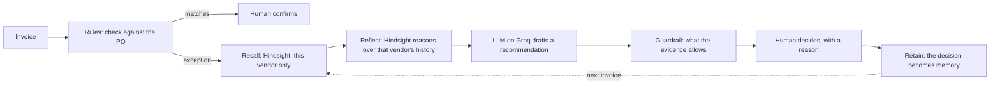
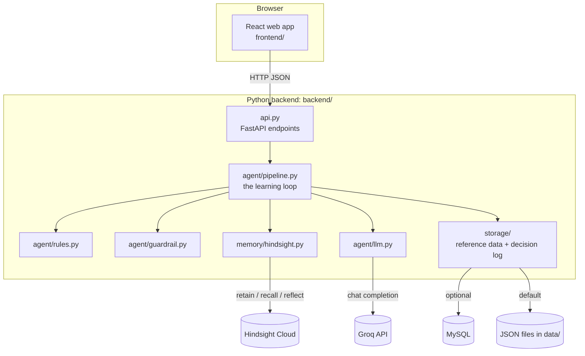

# PaySage: project guide

**Every invoice teaches the next one.** PaySage is an accounts-payable (AP) agent that checks invoices
against purchase orders, remembers how human reviewers resolved each exception and why, and uses that
memory, for the same vendor only, to recommend what to do the next time. A human always makes the final
call; every decision they make makes the next recommendation better.

This guide explains the whole project: the problem, what PaySage does, how it works, the tech and API
keys, why it is built this way, the alternatives, and a map of the code (which files to explain in
detail, and which in a sentence).

## Contents

1. [PaySage in one minute](#1-paysage-in-one-minute)
2. [The problem](#2-the-problem)
3. [What PaySage does](#3-what-paysage-does)
4. [How it works: the architecture](#4-how-it-works-the-architecture)
5. [Tech stack](#5-tech-stack)
6. [API keys and configuration](#6-api-keys-and-configuration)
7. [Why this design](#7-why-this-design)
8. [The code map](#8-the-code-map)
9. [Other solutions, and how PaySage compares](#9-other-solutions-and-how-paysage-compares)
10. [Running it](#10-running-it)
11. [Testing and verification](#11-testing-and-verification)
12. [Limitations and next steps](#12-limitations-and-next-steps)
13. [Glossary](#13-glossary)

---

## 1. PaySage in one minute

1. An invoice arrives. PaySage compares it with its **purchase order (PO)**: same price? same quantity?
2. If something doesn't match (an **exception**), PaySage asks **Hindsight**, its memory: *"What did a
   human decide last time this vendor had this exception?"*
3. An **LLM on Groq** drafts a recommendation and explains it. A deterministic **guardrail** then checks
   it: PaySage may recommend **approval only if a human already approved the exact same exception for
   the same vendor.** Otherwise it asks a human.
4. The **human decides** and writes one sentence of reason. That decision and reason are stored in
   Hindsight.
5. The next identical invoice from that vendor is recognized: *"I've seen this before. A reviewer
   approved it on 29 Sept because the contract price changed."*

The demo story, with real Groq and real Hindsight:

| Invoice | What happens |
|---|---|
| INV001 · ABC Pharma bills ₹550, PO says ₹500 | Exception. No memory. **Needs review.** The reviewer approves: "Contract price changed from ₹500 to ₹550 effective 2026-07-01". Stored in Hindsight. |
| INV002 · ABC Pharma bills ₹550 again | Hindsight recalls INV001. **Recommends approval**, citing the reviewer and the reason. |
| INV003 · XYZ Pharma bills ₹550 | Same amount, different vendor: ABC's memory is **not** used. **Needs review.** |
| INV004 · ABC Pharma bills ₹600 | Memory is shown as context, but ₹600 was never approved. **Needs review.** |

## 2. The problem

**Accounts payable** is the team that pays a company's suppliers. Before paying, they check that each
invoice matches what was ordered: the purchase order's price and quantity. When it doesn't, the
invoice becomes an **exception** and someone has to investigate.

What goes wrong today:

- **The same exceptions keep coming back.** A vendor's contract price goes up, but the POs still carry
  the old price. Every invoice from that vendor is flagged again, and someone re-investigates something
  a colleague already resolved last week.
- **The reasons live in people's heads.** Why was that ₹550 invoice approved? The answer is in an email,
  a comment field, or the memory of whoever handled it. When that person is away or leaves, the
  knowledge goes too.
- **Rule-based tools flag, but don't learn.** Matching software uses fixed tolerance rules. Someone has
  to write and maintain a rule for every legitimate exception, and a stale rule keeps approving.
- **A generic AI assistant can't be trusted with payments.** It forgets between sessions, it can
  confidently make things up, and it can't show a verified precedent. A wrong approval means paying
  money that isn't owed.
- **Mixing up vendors is dangerous.** An exception approved for one vendor must never be applied to
  another vendor that happens to bill the same amount.

How common exceptions are, in this project's own data: in the real USAID purchase data, **22%** of
lines differ from that year's contract price; in the synthetic dataset **28%** of invoices have an
exception, and **30** exception patterns repeat (the same vendor, type and amount more than once).
That repetition is exactly what a memory can learn from.

## 3. What PaySage does

### 3.1 The learning loop



| Step | What happens | Who does it |
|---|---|---|
| **Rules** | Compares price and quantity with the PO record. Price: CRITICAL above 10% off, WARNING above 5%, else INFO. Quantity: any difference is a WARNING, above 10% CRITICAL. The price an invoice *claims* the PO had is never trusted: the PO record wins. | Deterministic code |
| **Recall** | Asks Hindsight for past decisions about this vendor and exception. Anything about another vendor is dropped in code. | Hindsight + PaySage code |
| **Reflect** | Only if this vendor has memories: Hindsight answers "does this match an exception a human verified before?" in plain sentences. | Hindsight |
| **LLM** | Drafts a recommendation (APPROVED / REJECTED / NEEDS_REVIEW), a confidence and a 1-3 sentence explanation. | Groq (`openai/gpt-oss-120b`) |
| **Guardrail** | Decides what is allowed (below). Overrides the LLM if needed and says so. | Deterministic code |
| **Human** | Picks the decision and writes the reason. Nothing is pre-selected. | The reviewer |
| **Retain** | Stores the decision and reason in Hindsight, one memory per invoice. | Hindsight |

### 3.2 The safety rules

- **No approval without a verified precedent.** APPROVED needs a human-approved decision for the
  *same vendor*, *same exception type* and *same invoiced amount* (evidence level `VERIFIED_MATCH`).
- **Verified rejection:** if a reviewer rejected the same exception before, PaySage may recommend
  REJECTED.
- **Conflict:** if reviewers approved *and* rejected the same exception, a human must decide.
- **No evidence:** needs human review, always.
- **The LLM advises; the evidence decides.** If the LLM says "APPROVED" without evidence, the guardrail
  overrides it and the explanation says so. If Groq is down, the evidence rule still works.
- **Vendor isolation in code.** Every stored decision carries a machine-readable record naming its
  vendor; recall drops anything for another vendor, even if semantic search returns it.
- **Only human decisions are stored.** The agent never writes its own opinions into memory.
- **Honest failures.** "Memory offline" is reported differently from "no memory found", and a decision
  that couldn't be stored says "recorded, but not remembered" with a button to try again.
- **Secrets never leak.** Keys stay in `.env`, `/health` never returns them, and logs redact them.

### 3.3 The screens

| Screen | What it shows |
|---|---|
| **Dashboard** | The mascot's banner (from "ready to learn" to "smarter over time"), invoices processed, exceptions, approval rate, active vendors, exceptions by type, the learning-loop funnel (processed → decided → remembered), recent Hindsight memories, and "how every recommendation is made" |
| **Invoice review** | The queue (50 per page, opening at the first invoice that needs a decision). Run the agent: the mascot narrates the steps. Then the rule engine's findings, the recommendation with its evidence level and explanation, the recalled memories and Hindsight's reflection, and the decision form. |
| **Enter manually** | Type an invoice or upload a JSON file (one invoice or a list) |
| **Vendor memory** | Per vendor: decisions, approval rate, status (reliable / inconsistent / new), price history, and a timeline of everything processed and decided |
| **System panel** | Live status of the API, the LLM (Groq), memory (Hindsight) and where the data lives (files or MySQL) |

**The mascot** turns each situation into a line a person understands, and only claims what the system
really does: "Whoa! This invoice doesn't match the purchase order.", "I don't know this pattern yet.
Better check with you.", "I've seen this before. Based on verified history, I recommend approval.",
"Got it. I'll remember why you made that decision." The full table is in the README.

### 3.4 Data

| Dataset | What | Invoices |
|---|---|---|
| `demo` | The four-invoice story above | 4 |
| `real` | Every purchase line sold directly by an Indian manufacturer (Aurobindo, Hetero, Cipla, Mylan and others) in USAID's Supply Chain Management System dataset, 2006-2015, downloaded from Kaggle | 1,623 |
| `synthetic` | 12 invented Indian vendors, Jan-Sep 2026, with realistic exception patterns: price revisions the PO master hasn't caught up with, recurring overbilling, carton-rounded short shipments, rounding differences, extra truck trips | 482 |

Pick one with `DATASET` in `.env`. The data can come from JSON files (no setup) or from **MySQL**
(optional), which also keeps the dashboard's history across restarts. Sources and licenses are in
[data/SOURCES.md](../data/SOURCES.md).

## 4. How it works: the architecture



**"Run the agent"** calls `POST /api/v1/invoice/process`: rules → recall → reflect → LLM → guardrail,
and returns the recommendation, memories, reflection, evidence level and explanation. Nothing is stored
in Hindsight at this point.

**"Submit decision"** calls `POST /api/v1/invoice/store-decision`: the human's decision and reason are
retained in Hindsight and added to the decision log.

**Two stores, on purpose:**

| Store | Holds | Used for |
|---|---|---|
| **Hindsight** (memory) | Human decisions and their reasons | The agent's recommendations. This is the *only* history the agent reads. |
| **Decision log** (memory, a file, or MySQL) | Every processed invoice and decision | The dashboard and vendor pages, which refresh every 10 seconds without spending Groq or Hindsight credits |

## 5. Tech stack

| Layer | Technology | Used for |
|---|---|---|
| Backend language | Python 3.13 | Everything on the server |
| Web API | FastAPI 0.141, Uvicorn 0.54 | HTTP endpoints, automatic docs at `/docs` |
| Data validation | Pydantic 2.13 | Every request and response shape; bad input is a clear 422, never a crash |
| **AI memory** | **Hindsight** by Vectorize, `hindsight-client` 0.10.1 | Retain, recall and reflect on human decisions. Runs on Hindsight Cloud, or self-hosted (`hindsight-api` 0.10.2) |
| **LLM** | **Groq API**, `groq` SDK 1.7, model `openai/gpt-oss-120b` | Drafting the recommendation and explanation |
| Database (optional) | MySQL, SQLAlchemy 2.1, PyMySQL 1.2 | Vendors, POs, invoice queue, decision log. SQLite in tests |
| Real data | USAID SCMS dataset via Kaggle (`kagglehub`) | 1,623 real purchase lines from Indian manufacturers |
| Frontend | React 18.2, TypeScript 5.9 (strict), Vite 8 | The web app |
| Styling | Tailwind CSS 3.4, lucide-react icons | Layout, colours, icons |
| Charts | Recharts 3 | Exceptions by type |
| Routing, HTTP | React Router 6.30, axios | Pages, API calls |
| Testing | pytest 8.4, pytest-asyncio, pytest-cov, ESLint 10, TypeScript compiler | 273 backend tests, frontend type checks and lint |

## 6. API keys and configuration

All settings live in one file, `.env`, at the repository root. It is listed in `.gitignore`, so it is
never committed. `.env.example` shows every setting with placeholders.

**The two API keys this project uses:**

| Key | What it's for | Where to get it | Needed? |
|---|---|---|---|
| `GROQ_API_KEY` | The LLM that drafts recommendations and explanations | [console.groq.com/keys](https://console.groq.com/keys) (free tier works) | Yes. Without it, the guardrail still decides from memory, and the explanation says the LLM was unavailable |
| `HINDSIGHT_API_KEY` | Hindsight Cloud, the memory | [ui.hindsight.vectorize.io](https://ui.hindsight.vectorize.io) | Yes for Hindsight Cloud; not for a self-hosted server on your machine |

**Other settings:**

| Setting | What it's for |
|---|---|
| `HINDSIGHT_BANK_ID` | Which memory bank to use. Create a fresh one with `python -m scripts.fresh_bank` |
| `HINDSIGHT_API_URL` | Hindsight Cloud (default) or a local server (`http://127.0.0.1:8888`) |
| `GROQ_MODEL` | The Groq model (default `openai/gpt-oss-120b`) |
| `DATASET` | `demo`, `real` or `synthetic` |
| `MYSQL_HOST`, `MYSQL_PORT`, `MYSQL_USER`, `MYSQL_PASSWORD`, `MYSQL_DATABASE` | Optional MySQL storage |
| `DATA_DIR`, `INVOICES_FILE`, `DECISION_LOG_PATH`, `CORS_ORIGINS` | Optional: a custom data folder, a decision log file, extra allowed web origins |
| `VITE_API_URL`, `VITE_APP_NAME` (in `frontend/.env.local`) | Where the web app finds the API; the app's name |

Kaggle needs no key: the dataset is public and downloads anonymously.

**How the keys are protected:** they are only read from `.env`; `/health` reports "configured" or
"reachable", never a value; the logger replaces the configured keys (and the MySQL password) with
`[redacted]` in every line; `check_setup` never prints them; and tests fail if a dummy secret ever
appears in a response or a log line.

Check everything with real calls that cost nothing: `python -m scripts.check_setup` (from `backend/`).

## 7. Why this design

| Choice | Why |
|---|---|
| **Remember decisions, not write rules** | Reviewers make these decisions anyway. Capturing the reason costs them one sentence, and the next identical invoice is handled with a cited precedent. No one has to write or maintain rules. |
| **Hindsight for memory** | It is built for agent memory: *retain* extracts facts from text with timestamps, *recall* searches them several ways at once (meaning, keywords, entities, time) and reranks the results, and *reflect* reasons over them. Banks keep separate memories apart. Building this ourselves would mean a vector database, embeddings, fact extraction and retrieval tuning. Hindsight was also the project brief's required memory. |
| **Vendor isolation in our own code** | Semantic search is fuzzy: "ABC Pharma at ₹550" is *similar* to "XYZ Pharma at ₹550". Each stored decision carries an exact record line (`[AP-RECORD vendor=…]`), and recall drops anything for another vendor. Tests use a deliberately leaky fake memory to prove it. |
| **A deterministic guardrail over the LLM** | LLMs vary between runs and can be steered by text hidden in stored data (prompt injection). Paying money needs a rule you can audit: the LLM explains; the evidence decides. |
| **A human in the loop, always** | AP controls require a person to approve payments. PaySage recommends; people decide. |
| **Groq for the LLM** | Very fast responses (it feels live in a demo), a free tier, an OpenAI-compatible API, and open-weight models. The LLM sits in one module, so it can be swapped. |
| **FastAPI + React** | Typed request and response models with automatic API docs; a responsive UI with TypeScript catching mistakes at build time. |
| **JSON files by default, MySQL optional** | Anyone can run it with zero setup; a real database is one `.env` change away. SQLAlchemy keeps the same code working on MySQL and SQLite. |
| **Real and synthetic data** | Real data proves it works on real vendors and prices; synthetic data adds the repeated exception patterns (and expected decisions) needed to show learning at scale. |

## 8. The code map

### Folder structure

```
.
├── README.md                     quick start
├── .env.example                  every setting, with placeholders (copy to .env)
├── backend/                      Python: API, agent, memory, storage, tools, tests
│   ├── api.py                    ★ HTTP API: every endpoint the web app calls
│   ├── cli.py                    the same pipeline in the terminal
│   ├── app/
│   │   ├── config.py             settings from .env
│   │   ├── models.py             every data shape (invoice, PO, exception, recommendation, responses)
│   │   ├── agent/                the decision pipeline
│   │   │   ├── pipeline.py       ★ the learning loop, step by step
│   │   │   ├── rules.py          ★ invoice-vs-PO checks
│   │   │   ├── guardrail.py      ★ what the evidence allows
│   │   │   └── llm.py            ★ the Groq prompt, call and parsing
│   │   ├── memory/
│   │   │   └── hindsight.py      ★ retain, recall, reflect with Hindsight
│   │   ├── storage/
│   │   │   ├── reference.py      vendors, POs and the invoice queue
│   │   │   ├── decision_log.py   history behind the dashboard
│   │   │   ├── database.py       MySQL tables
│   │   │   └── sources.py        chooses JSON files or MySQL
│   │   └── utils/
│   │       ├── logs.py           logging, with secrets redacted
│   │       └── display.py        terminal output for cli.py
│   ├── scripts/                  tools: check_setup, fresh_bank, local_hindsight, db,
│   │                             download_real_data, generate_synthetic_data
│   ├── tests/                    unit, api, e2e, live, integration tests + fakes + fixtures
│   └── requirements.txt          Python dependencies (requirements-dev.txt adds the test tools)
├── frontend/                     React + TypeScript web app
│   └── src/
│       ├── pages/                Dashboard, InvoiceReview ★, VendorMemory, NotFound
│       ├── components/           common/, dashboard/, invoice/, vendor/, layout/
│       ├── hooks/                data loading: useInvoice ★, useDashboard, useVendorMemory
│       ├── api/                  axios client and typed endpoints ★
│       ├── types/                TypeScript shapes of the API's responses
│       ├── utils/                mascot states ★, formatters, validators, constants
│       ├── assets/mascot/        the mascot's poses
│       └── styles/               colours, animations, global CSS
├── data/                         datasets: demo files, real/, synthetic/, SOURCES.md
└── docs/                         this guide, the demo script, the logo and mascot
```

★ = the files to explain in detail. Everything else gets a sentence.

### Main files: explain these in detail

**1. `backend/app/agent/pipeline.py`: the learning loop.** *Start here.*
- `InvoiceProcessor.process(invoice)` runs the loop in order:
  1. find the PO;
  2. `RuleEngine.detect_exceptions` (if none, it's a match that a human still confirms);
  3. `HindsightMemory.recall`, keeping this vendor only;
  4. `reflect`, only if there are memories;
  5. `assess` the evidence;
  6. `LLMAgent.recommend`;
  7. `decide` (the guardrail);
  8. log the result.

  Each step logs one line, and each failure degrades gracefully: memory offline means "needs review", Groq down means the evidence rule decides.
- `InvoiceProcessor.store_decision(request)` retains the human decision in Hindsight and records it
  in the decision log. The response says honestly whether it was remembered.
- *Say:* "This one file is the product: rules, memory, LLM, guardrail, human, memory again."

**2. `backend/app/agent/rules.py`: the checks.**
- `RuleEngine.detect_exceptions(invoice, po)` compares price and quantity with the PO. `price_severity`
  and `quantity_severity` set the levels, and `PRICE_TOLERANCE` (half a paisa) absorbs rounding noise.
  The most severe exception comes first.
- *Say:* "No AI here on purpose: an exception has to be reproducible."

**3. `backend/app/memory/hindsight.py`: the memory.**
- `retain`: stores one decision per invoice (`document_id = ap-decision-<invoice>`, so resubmitting
  replaces it rather than duplicating it). It stores readable prose for Hindsight to extract facts from,
  plus one exact `[AP-RECORD vendor=…|type=…|po=…|invoice=…|decision=…|reason=…]` line.
- `recall`: asks Hindsight a natural-language question, reads each result's `AP-RECORD` back from the
  original text, and drops anything for another vendor or without a readable record.
- `reflect`: asks Hindsight, about this vendor only, whether the current exception matches a verified
  one. The answer is in plain sentences.
- `explain_failure` turns errors into plain words ("invalid Hindsight API key", "bank not found").
  `create_fresh_bank` makes an empty bank for a clean demo.
- *Say:* "Hindsight remembers; our code decides whose memory counts."

**4. `backend/app/agent/guardrail.py`: the evidence rules.**
- `assess(vendor, exceptions, memories)` gives each exception an evidence level: `VERIFIED_MATCH`,
  `VERIFIED_REJECT`, `CONFLICT` or `NO_EVIDENCE`. It compares vendor, exception type and invoiced
  amount (to ₹0.01).
- `decide(...)` takes the LLM's suggestion and applies the rules. APPROVED without `VERIFIED_MATCH` is
  overridden, and the explanation says so. If the LLM is down or its output is unreadable, the evidence
  alone decides.
- *Say:* "The model can suggest anything; it can only approve what a human already approved."

**5. `backend/app/agent/llm.py`: the LLM step.**
- `SYSTEM_PROMPT` sets the analyst's rules. `build_messages` puts the invoice, PO, exceptions, evidence
  level, memories and reflection inside a `<data>` block that the prompt marks as untrusted, which
  defends against prompt injection. `parse_llm_output` reads the JSON answer robustly.
  `LLMAgent.recommend` calls Groq.
- *Say:* "Memories are data, never instructions."

**6. `backend/api.py`: the HTTP API.**
- The endpoints: process an invoice, store a decision, the queue (paged) and its summary, the
  dashboard, vendors, and health. Clients (Groq, Hindsight, the database) are created on first use
  through FastAPI's dependency injection, so tests can swap in fakes. Every error has the same shape:
  `{"error": {"code", "message"}}`.
- *Say:* "Thin on purpose: validation, wiring, errors. The logic lives in the pipeline."

**7. `frontend/src/pages/InvoiceReview.tsx`: the reviewer's screen.**
- It shows the queue, runs the agent (with the mascot narrating the real steps), and shows the rule
  engine, the recommendation, the memories and the reflection. It then collects the decision and moves
  to the next invoice or the next page. Manual entry and JSON upload live here too.

**8. `frontend/src/hooks/useInvoice.ts` + `frontend/src/api/endpoints.ts`: how the UI talks to the API.**
- `useInvoice` holds one invoice's state (processing, result, decision outcome). `useInvoiceQueue`
  loads the queue a page at a time. `endpoints.ts` has one typed function per API call.

**9. `frontend/src/utils/mascot.ts`: the mascot's brain.**
- `MASCOT_STATES` lists every situation (pose, colour, title, line). `stateForResult`,
  `stateForExceptions` and `stateForOutcome` pick the state from the API's response, for example
  `VERIFIED_MATCH` + APPROVED gives "I've seen this before. Based on verified history, I recommend approval."

### Supporting files: one sentence each

| File | What it does |
|---|---|
| `backend/app/config.py` | Reads settings from `.env`; placeholders like `your_key` count as unset; picks the dataset folder |
| `backend/app/models.py` | Every data shape, with validation (positive prices, ISO dates, non-blank reasons) |
| `backend/app/storage/reference.py` | Loads vendors, POs and the invoice queue; finds an invoice's PO by `po_id` |
| `backend/app/storage/decision_log.py` | Records every processed invoice and decision; computes dashboard and vendor stats |
| `backend/app/storage/database.py` | MySQL tables, dataset import, and the decision-log event store |
| `backend/app/storage/sources.py` | Chooses JSON files or MySQL, and imports a dataset on first start |
| `backend/app/utils/logs.py` | Logging with API keys redacted |
| `backend/app/utils/display.py` | The formatted terminal output of `cli.py` |
| `backend/cli.py` | The whole pipeline in the terminal, with a human at the keyboard |
| `backend/scripts/check_setup.py` | Tests the Groq key, the Hindsight key and bank, and MySQL, for free |
| `backend/scripts/fresh_bank.py` | Creates an empty Hindsight bank for a clean demo |
| `backend/scripts/local_hindsight.py` | Runs Hindsight on your own machine, sized for Groq's free tier |
| `backend/scripts/db.py` | MySQL: import datasets, show status, clear the decision log |
| `backend/scripts/download_real_data.py` | Downloads the USAID dataset from Kaggle and converts it to PaySage's format |
| `backend/scripts/generate_synthetic_data.py` | Generates the synthetic dataset (deterministic, with labels) |
| `backend/tests/fakes.py` | Fake Groq and Hindsight that check every call against the real clients' signatures |
| `backend/tests/*` | Unit, API, end-to-end, live and MySQL tests |
| `frontend/src/components/*` | The building blocks: cards, buttons, the mascot, charts, the decision form |
| `frontend/src/pages/Dashboard.tsx`, `VendorMemory.tsx` | The dashboard and vendor pages |
| `frontend/src/types/*` | TypeScript versions of the API's shapes |
| `frontend/src/utils/*` (other) | Currency and date formatting, form validation, constants |

## 9. Other solutions, and how PaySage compares

Yes, there are other ways to handle invoice exceptions:

| Approach | How it works | Where it falls short |
|---|---|---|
| **Manual review** (spreadsheets, email) | A person checks every exception | Slow; the same exception is re-investigated; reasons are lost when people move on |
| **AP automation in ERPs and AP platforms** | Two- or three-way matching with tolerance rules; exceptions are routed to people | Mostly rule-driven. Many now add AI features, but a reviewer's reasoning usually ends up as a comment, not as evidence the next decision can cite |
| **Hand-written rules per vendor** ("accept ABC at ₹550") | Someone codes every legitimate exception | Rules must be written and maintained; they don't carry the reason; a stale rule keeps approving |
| **Ask a chatbot / LLM directly** | Paste the invoice, ask "approve?" | No memory of your company's decisions; can invent facts; no audit trail; can't be allowed to approve |
| **Fine-tune a model on past decisions** | Train a model on historical approvals | Needs lots of data and retraining for every new decision; hard to explain or correct; learns slowly |
| **Build your own RAG** (vector database + embeddings) | Store past decisions as vectors and search them | Possible, but you build chunking, fact extraction, time handling, retrieval tuning and reasoning yourself |
| **Other agent-memory products** (for example Mem0, Zep, Letta) | Hosted or open-source memory layers for agents | Real alternatives for the memory layer. PaySage's memory code is one module, so it could be swapped |

**What makes PaySage different:**

- **It learns from one decision, immediately.** No retraining, no rule writing.
- **It explains with evidence.** It cites the reviewer, the date and the reason.
- **It can't approve without a verified precedent.** The guardrail is code, not a prompt.
- **Vendors never share memory.** This is enforced in code and proven by tests.
- **People stay in control.** It recommends; a human decides.

## 10. Running it

From the repository root, once:

```bash
python -m venv .venv && .venv/Scripts/activate      # macOS/Linux: source .venv/bin/activate
pip install -r backend/requirements.txt
cp .env.example .env                                 # add GROQ_API_KEY and HINDSIGHT_API_KEY
cd frontend && npm install
```

Every time (two terminals):

```bash
cd backend && uvicorn api:app --reload              # API on http://127.0.0.1:8000 (docs at /docs)
cd frontend && npm run dev                          # web app on http://localhost:3000
```

Useful, from `backend/`: `python -m scripts.check_setup` (is everything connected?),
`python -m scripts.fresh_bank --prefix hap-demo` (a clean memory bank), `python cli.py` (terminal
version). The presenter's script is [demo_walk.md](demo_walk.md).

## 11. Testing and verification

- **262 offline backend tests** run in about 15 seconds with no network. Groq and Hindsight are
  replaced by fakes that check every call against the real clients' signatures. The Hindsight fake is
  deliberately leaky (it returns every vendor's memories) to prove that vendor isolation comes from
  PaySage. Any network access fails a test. The tests cover:
  - the learning loop end to end;
  - every guardrail rule;
  - LLM failures and malformed output;
  - Hindsight failures;
  - the API contract;
  - secret redaction;
  - the datasets;
  - MySQL storage (on SQLite).
- **Live rehearsal** (4 tests, opt-in): the demo story three times on real Groq and Hindsight, each
  time on a fresh bank; it must give the same recommendations every time.
- **MySQL integration** (7 tests, opt-in): the storage code on a real MySQL server.
- **Frontend:** TypeScript in strict mode and ESLint, both clean; a production build.
- **Checked in a real browser** (Microsoft Edge, driven by Playwright) at desktop and phone widths,
  and the demo story was run for real on Groq and Hindsight Cloud.

## 12. Limitations and next steps

**Today:**

- Checks price and quantity only. There is no goods-receipt (three-way) match, no GST/tax check and no
  duplicate-invoice detection.
- It recommends, but doesn't pay: there is no ERP integration.
- There are no user accounts or roles.
- Evidence must match the invoiced amount exactly (to ₹0.01). A new price needs one human decision
  first, which is intentional.
- On Groq's free tier, rate limits can occasionally skip a reflection. The recommendation still works.

**Next:**

- Read invoices from email or PDF.
- Add GST checks and duplicate detection.
- Add reviewer accounts with approval limits.
- Evaluate accuracy against `data/synthetic/labels.json` (the decision a careful reviewer would make).
- Connect to an ERP.
- Deploy: the frontend on Vercel, and the API on a small server.

## 13. Glossary

| Term | Meaning |
|---|---|
| **Accounts payable (AP)** | The team and process that pays a company's suppliers |
| **Purchase order (PO)** | What the company agreed to buy: item, price, quantity |
| **Invoice exception** | An invoice that doesn't match its PO (price or quantity) |
| **Tolerance** | How much difference is accepted as noise (here: half a paisa on price) |
| **Two-/three-way match** | Checking invoice vs PO (two-way), plus vs goods received (three-way) |
| **Hindsight bank** | One isolated memory store; PaySage uses one per demo |
| **Retain / recall / reflect** | Hindsight's three operations: store a memory, search memories, reason over them |
| **Evidence level** | PaySage's verdict on the memory: `VERIFIED_MATCH`, `VERIFIED_REJECT`, `CONFLICT`, `NO_EVIDENCE` (`NOT_REQUIRED` when there is no exception) |
| **Guardrail** | The code that decides what the LLM is allowed to recommend |
| **Human in the loop** | A person makes every final decision |
